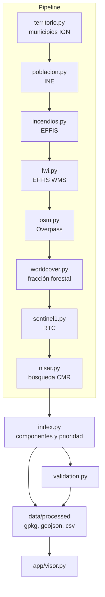

# Arquitectura

El programa es un pipeline por fases que deja un GeoPackage y un GeoJSON ligeros, y un visor Streamlit que solo lee esos ficheros. No hay base de datos ni servicio propio.

## Paquetes

| Ruta | Responsabilidad |
|---|---|
| `src/prioridad_galicia/config.py` | Ámbito, CRS, fechas, pesos, rutas de salida. |
| `src/prioridad_galicia/cli.py` | `pipeline`, `nisar-buscar`, `nisar-procesar`. |
| `src/prioridad_galicia/pipeline.py` | Orden de las fases, captura de fallos, escritura. |
| `src/prioridad_galicia/http_client.py` | GET/POST con reintentos. No registra cabeceras. |
| `src/prioridad_galicia/geo.py` | Rejilla EPSG:25830, rasterizado de municipios, estadística zonal, reproyección. |
| `src/prioridad_galicia/normalize.py` | Min-max robusto y media ponderada que respeta los NaN. |
| `src/prioridad_galicia/index.py` | Construcción de COMB, HIST, FWI, EXPO, ACCES y de la prioridad 0–100. |
| `src/prioridad_galicia/validation.py` | Captura de hectáreas, AUC y gráfico de quintiles. |
| `src/prioridad_galicia/sources/` | Un módulo por fuente. Ninguno rellena con datos inventados. |
| `app/visor.py` | Mapa, top 10, ficha y pesos. Recalcula la prioridad en memoria. |
| `tests/` | Normalización, índice, lector GCOV sintético, zonal y AUC. |
| `data/cache/` y `data/raw/` | Descargas y rejillas intermedias. No van al repositorio. |
| `data/processed/` | Productos ligeros que el visor abre sin volver a descargar. |

## Contrato entre fases

Cada fase recibe el `GeoDataFrame` de municipios y devuelve el mismo objeto con columnas nuevas, más un diccionario de procedencia. Si la fase lanza una excepción, `pipeline._fase` anota el error en el manifiesto y sigue con la tabla anterior. Después, las columnas que nadie pudo crear se dejan vacías (`pd.NA`), no a cero. El cero solo aparece cuando la fuente respondió y el municipio, de verdad, no tiene incendios o no tiene vía principal.

La prioridad no se recalcula dentro de las fases. `construir_componentes` y `calcular_prioridad` corren una vez, al final, con el preset `equilibrado`. El visor vuelve a llamar a `calcular_prioridad` con los pesos de la pantalla: por eso los componentes 0–1 viajan en el GeoJSON y no hace falta repetir el SAR para mover un deslizador.

## Sistema de referencia

Todo el cálculo métrico (áreas, distancias, rejilla) está en EPSG:25830. El WFS del IGN se pide en EPSG:4258 (ETRS89 geográfico, el nativo del servicio) y se reproyecta en `cargar_municipios`. El GeoJSON de salida vuelve a EPSG:4326 porque Folium lo espera así. El GeoPackage se queda en 25830.

## Caché

| Caché | Contenido |
|---|---|
| `data/cache/ign_unidades_galicia.geojson` | Respuesta bruta del WFS. |
| `data/cache/municipios_25830.gpkg` | Municipios ya filtrados y proyectados. |
| `data/cache/s1/res400/*.npz` | VH y VV de cada escena ya en la rejilla de trabajo. |
| `data/raw/nisar/` | HDF5 descargados. Se borran al acabar salvo `--conservar`. |

`--forzar` ignora la caché de municipios y la de escenas Sentinel-1.

## Qué no hay

No hay orquestador externo (no Make es obligatorio; el `Makefile` solo abrevia comandos). No hay cuenta de Google Earth Engine. No hay modelo entrenado: el índice es una suma ponderada y los pesos se ven.
