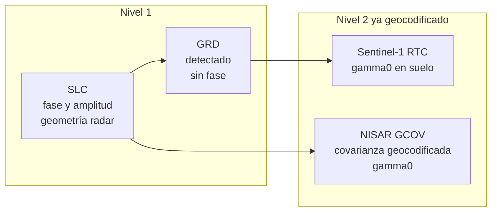
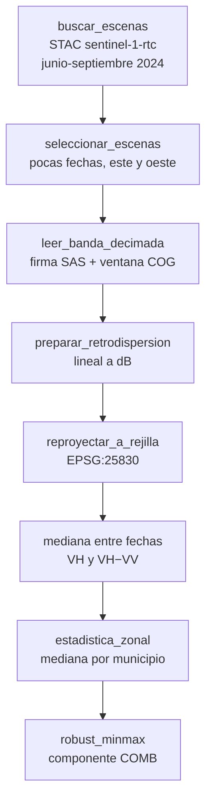
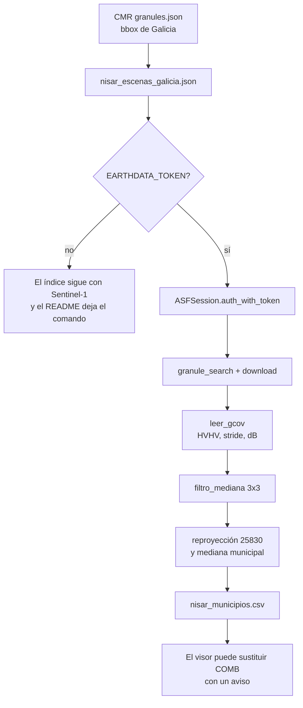

# Datos de satélite SAR en este proyecto

Este documento explica, de principio a fin, qué se hace con el radar y en qué función del código ocurre cada paso. No hace falta haber procesado SAR antes. Las cifras de la última ejecución (cuántas escenas entraron, si NISAR se pudo descargar) están en `data/processed/manifiesto.json`, no aquí: aquí está el método.

## 1. Qué problema resuelve el radar en un índice de incendios

Un gestor que decide dónde desbrozar, abrir una faja o preposicionar un medio necesita saber **cuánta estructura vegetal hay** y **dónde el fuego ya ha demostrado que se repite**. La óptica (Sentinel-2, Landsat) ve el color de la cubierta y se queda ciega con nubes, que en Galicia son la norma. El radar de apertura sintética (SAR) ilumina él mismo la superficie con microondas y mide lo que vuelve. Atraviesa la nube y opera de día y de noche.

Lo que vuelve no es una fotografía. Es una potencia, llamada retrodispersión, que depende de la rugosidad y de la estructura del blanco respecto a la longitud de onda. En vegetación, las ramas y hojas del tamaño de esa longitud de onda rebotan la energía entre ellas (dispersión de volumen). Cuanto más volumen, más vuelve, hasta un punto de saturación. Por eso la retrodispersión en polarización cruzada se usa como **proxy de biomasa y, en prevención, de carga de combustible**. No es un peso en toneladas por hectárea calibrado: es un orden territorial, comparable entre municipios de Galicia en la misma campaña.

## 2. Qué es un SAR, en corto

Un SAR va en un satélite, emite un pulso lateral y registra el eco con la hora exacta de llegada (eso da la distancia, el *range*) y con el desplazamiento Doppler a lo largo de la órbita (eso afina la posición a lo largo de la traza, el *azimuth*). Combinando muchos pulsos se sintetiza una antena de kilómetros y se consigue una resolución de metros desde 700 km de altura.

Tres ideas bastan para leer el resto:

1. **La geometría es lateral.** Las laderas que miran al satélite se acortan y se ven brillantes (*foreshortening*, *layover*). Las que miran al otro lado pueden quedar en sombra. Por eso un producto útil para comparar municipios ya viene corregido por el relieve.
2. **La medida es una potencia ruidosa.** Un mismo bosque, en dos píxeles vecinos, puede dar valores muy distintos por el *speckle* (apartado 7).
3. **La longitud de onda elige qué “ve”.** Eso es la banda.

## 3. Bandas: L, S y C

| Banda | Longitud de onda | Quién la lleva aquí | Qué atraviesa | Saturación orientativa en bosque |
|---|---|---|---|---|
| C | ~5,6 cm | Sentinel-1 | Hojas y ramas finas. Se queda en la parte alta de la copa. | Baja: a menudo entre 20 y 100 t/ha según el tipo de masa. Por encima, bosques distintos se ven parecidos. |
| S | ~9–12 cm | NISAR (instrumento de ISRO) | Una posición intermedia entre C y L. | Entre C y L. En el producto NISAR es la frecuencia B. |
| L | ~24 cm | NISAR (instrumento de NASA) | Penetra más en la copa y llega a ramas gruesas y, en masas abiertas, al suelo. | Más alta. Distingue mejor cargas de combustible grandes, que son las que importan en un incendio de copas. |

Sentinel-1 lleva años de archivo y cubre Galicia cada pocos días (12 días por satélite y geometría; con Sentinel-1A y 1B/1C y órbitas ascendente y descendente, bastante más). NISAR, lanzado para dar banda L de forma sistemática, tiene revisita de unos 12 días (cerca de 6 si se juntan ascendente y descendente) y **no sirve para ver un incendio en tiempo real**. Sirve para describir el estado del monte entre pasadas. Ese es exactamente el uso de este MVP: prevención, no detección.

En el código, la banda L se prefiere al leer el HDF5: `leer_gcov` puntúa mejor las rutas que contienen `frequencyA`. En la convención del producto NISAR, la frecuencia A es la banda L y la frecuencia B es la banda S. La función `_preferir` está en `src/prioridad_galicia/sources/nisar.py`.

## 4. Polarización

La antena puede emitir y recibir en horizontal (H) o vertical (V). El nombre tiene dos letras: la primera es la de emisión, la segunda la de recepción.

- **VV y HH** (co-polarizadas). Domina la reflexión de superficie: suelo, agua en calma, tejados, troncos alineados con la polarización. El urbano brilla mucho en VV por el doble rebote entre suelo y fachada.
- **VH y HV** (cruzadas). La vegetación despolariza: la energía entra en V y parte vuelve en H porque las ramas no tienen una orientación única. Por eso **VH/HV es el canal de volumen** y el que usamos como proxy de combustible.
- El **ratio VH/VV** (en dB, una resta) baja en el urbano, donde VV está disparado, y sube en el monte. Ayuda a que una ciudad no gane el índice solo por ser brillante.

Sentinel-1, en el modo interferométrico ancho (IW) sobre tierra europea, se adquiere casi siempre en doble polarización VV+VH. NISAR puede adquirir HH+HV, VV+VH o polarimetría más completa. En el producto GCOV la potencia de cada canal es el término diagonal de la matriz de covarianza:

| Término del GCOV | Qué es |
|---|---|
| `HHHH` | Potencia HH |
| `HVHV` | Potencia HV (el que buscamos) |
| `VVVV` | Potencia VV |
| `HHHV`, `VVVH` | Términos cruzados complejos. No los usamos: no son una potencia. |

`leer_gcov` recorre el HDF5, se queda con datasets 2D llamados `HHHH`, `HVHV` o `VVVV`, y elige en este orden: polarización cruzada, frecuencia A (banda L), y dentro de ellas `HVHV` antes que `HHHH`. Si un producto solo trae HH, lo lee y lo declara en el campo `polarizacion` para no disfrazarlo de HV.

## 5. Productos: SLC, GRD, RTC y GCOV

No se descarga “el SAR”. Se descarga un nivel de procesado. Confundirlos cambia el significado del número.



- **SLC** (*Single Look Complex*). Conserva la fase. Hace falta para interferometría (deformación del terreno, coherencia). No lo usamos: el índice no mide deformación, mide estructura vegetal.
- **GRD** (*Ground Range Detected*). Potencia detectada, proyectada a rango terreno, sin fase. Sigue teniendo el efecto del relieve: la ladera que mira al radar es más brillante aunque el monte sea el mismo. Comparar municipios con GRD mezclaría combustible y pendiente.
- **RTC** (*Radiometrically Terrain Corrected*). El GRD dividido por el área iluminada real de cada píxel, usando un modelo digital del terreno. La magnitud habitual es **gamma0 (γ⁰)**: potencia normalizada por el área proyectada en el plano perpendicular a la línea de visión. Es lo que publica Planetary Computer en la colección `sentinel-1-rtc`.
- **GCOV** (*Geocoded Covariance*). Producto de nivel 2 de NISAR. Parte del SLC, forma la matriz de covarianza polarimétrica, aplica una corrección radiométrica de terreno (pasa de beta0 a gamma0) y geocodifica a una malla UTM con multilook adaptativo. Ya no hay que hacer el RTC nosotros. Hay que leer el HDF5, pasar a dB y agregar.

Beta0, sigma0 y gamma0 son tres normalizaciones de la misma potencia. Beta0 normaliza por el área en el plano de la imagen radar (y por eso crece en las laderas de cara). Sigma0 normaliza por el área en el suelo horizontal. Gamma0 normaliza por el área perpendicular al haz y es la más estable para comparar cubiertas en terreno movido. **Trabajamos en gamma0** porque los dos productos que entran (RTC y GCOV) ya lo son.

## 6. De lineal a decibelios

La potencia lineal es asimétrica: un bosque puede valer 0,05 y un doble rebote urbano 2. En decibelios el contraste se parece más a cómo se interpretan estas imágenes y los outliers no dominan una media.

\[
\gamma^0_{\mathrm{dB}} = 10 \log_{10}(\gamma^0)
\]

Un gamma0 de 0,1 es −10 dB. Uno de 0,01 es −20 dB. Valores ≤ 0 no son potencia y pasan a hueco: no se sustituyen por cero, porque 0 dB sería un blanco fortísimo.

En el código:

- `gamma0_a_db` (`sources/nisar.py`) hace la fórmula y pone NaN en lo no positivo.
- `preparar_retrodispersion` (`sources/sentinel1.py`) enmascara antes el nodata del GeoTIFF (en el RTC de Planetary Computer es −32768). Si la mediana de lo que queda ya es negativa, el ráster venía en dB y no se vuelve a convertir. Si es positiva, se asume potencia lineal, que es el caso documentado de `sentinel-1-rtc`.

El test `test_gamma0_a_db_de_la_decima_parte` fija 0,1 → −10 dB para que esta convención no se mueva en silencio.

## 7. Speckle y mediana multitemporal

El speckle no es un fallo del sensor: es la interferencia, dentro del píxel, de muchos dispersores. En una sola fecha, un pinar puede oscilar varios dB de un píxel al de al lado. Para un índice municipal eso sobra.

Hay tres reducciones, y este MVP usa las tres de forma explícita:

1. **El producto ya está multilooked.** El GRD de Sentinel-1 y el GCOV de NISAR prometen varias vistas. No partimos de un SLC.
2. **Mediana espacial ligera en NISAR.** `filtro_mediana` sustituye cada píxel por la mediana de su vecindad 3×3, ignorando NaN. En Sentinel-1 el equivalente es la lectura decimada: al pedir un píxel de 400 m desde uno de 10 m, GDAL promedia el overview (`Resampling.average` en `leer_banda_decimada`). Eso es un multilook espacial adicional, no una lectura a plena resolución.
3. **Mediana entre fechas.** Para cada píxel de la rejilla se toma la mediana de las escenas del verano de 2024. La mediana, a diferencia de la media, no la arrastra una fecha con lluvia o un brillo anómalo. El filtro multitemporal clásico (Quegan y Yu, 2001) conserva mejor la resolución porque pondera; la mediana es más simple y, una vez que el número va a agregarse por municipio, suficiente.

No se calcula coherencia interferométrica. La coherencia distingue bien una corta o un incendio reciente, pero exige parejas SLC coregistradas y no es lo que pide el índice de prevención de este MVP.

## 8. Sentinel-1: de la búsqueda al número municipal

Fuente: colección `sentinel-1-rtc` del [planeta de datos de Microsoft Planetary Computer](https://planetarycomputer.microsoft.com/dataset/sentinel-1-rtc). Es abierta y no pide cuenta. El catálogo es un STAC (`https://planetarycomputer.microsoft.com/api/stac/v1`). Cada escena pesa del orden de 1–2 GB por polarización a 10 m; por eso **no se descarga el TIFF**. Se lee una ventana del COG (Cloud Optimized GeoTIFF) por HTTP, usando los overviews.



Funciones, todas en `src/prioridad_galicia/sources/sentinel1.py` salvo que se diga otra cosa:

| Paso | Función | Qué hace |
|---|---|---|
| Buscar | `buscar_escenas` | Pide ítems STAC en el bbox de Galicia y en `S1_INICIO`–`S1_FIN` (`config.py`). Descarta los que no tengan VH y VV o no sean modo IW. |
| Elegir | `seleccionar_escenas` | No procesa las decenas o cientos de pasadas del verano. Agrupa por semana ISO, toma hasta cuatro semanas repartidas y, en cada una, la escena que más cubre Galicia y otra cuyo centro caiga lejos (este/oeste). El tope es `--max-escenas-s1` (8 por defecto). |
| Firmar | `planetary_computer.sign` | Planetary Computer exige una firma SAS de corta duración en la URL del blob. La pone el cliente; no hay usuario ni clave que guardar. |
| Recortar | `leer_banda_decimada` | Transforma el bbox de Galicia al CRS de la escena (suele ser UTM 29N, EPSG:32629), calcula la ventana y la lee con `out_shape` para que el píxel salga cerca de la resolución de trabajo (400 m por defecto). GDAL usa el overview del COG: no bajan los 1,8 GB. |
| dB | `preparar_retrodispersion` | Apartado 6. |
| Reproyectar | `reproyectar_a_rejilla` en `geo.py` | Lleva VH y VV a una malla única alineada a EPSG:25830, la misma de los municipios. El destino nace en NaN: donde la escena no llega no se inventa un cero. |
| Mediana | `calcular_sentinel1` | `np.nanmedian` sobre la pila. También guarda `n_obs_sar`, la mediana de cuántas fechas cubren el municipio. |
| Agregar | `estadistica_zonal` | Rasteriza el código de municipio (`rasterizar_zonas`, `all_touched=True` para no perder concellos pequeños) y toma la mediana de los píxeles finitos. |
| Ratio | dentro de `calcular_sentinel1` | Por escena, VH(dB) − VV(dB); luego mediana entre escenas. Es el ratio en dominio logarítmico. |
| Normalizar | `construir_componentes` en `index.py` | `COMB = 0,55·norm(VH) + 0,45·norm(VH−VV)`, con reparto del peso si a un municipio le falta uno de los dos. |

La ventana temporal es el verano de 2024 a propósito. La validación usa incendios de 2025 y 2026. Un combustible medido en 2026 ya habría visto parte de esos incendios (el suelo quemado oscurece la banda C durante un tiempo) y la validación dejaría de ser retrospectiva.

La caché de cada escena reproyectada está en `data/cache/s1/` (no se sube al repositorio). Si la rejilla no cambia, la segunda ejecución no vuelve a leer los COG.

Resolución. 400 m no es la resolución del sensor. Es la resolución a la que el índice municipal es estable y cabe en esta máquina sin terabytes. Un concello de 10 km² sigue teniendo decenas de píxeles. El método (mediana, dB, zonal, min-max) es el mismo que a 20 m; cambia el detalle interno del municipio, que el índice no enseña.

## 9. NISAR: buscar sin cuenta, procesar con token

El archivo GCOV está en el ASF DAAC y se descubre por el CMR de NASA. **La búsqueda es pública.** La descarga del HDF5 no: Earthdata Login devuelve 401 sin un token de usuario.

Colecciones que consulta `buscar_nisar`:

- `NISAR_L2_GCOV_PROVISIONAL_V1` (calibración provisional, la preferida para procesar)
- `NISAR_L2_GCOV_BETA_V1` (pre-calibración; se lista y se usa solo si no hay provisional)



### 9.1 Búsqueda

`_paginar_cmr` llama a `https://cmr.earthdata.nasa.gov/search/granules.json` con `short_name` y `bounding_box` (oeste, sur, este, norte). Lee el total en la cabecera `CMR-Hits` y pagina de 200 en 200. De cada gránulo guarda identificador, título, colección, fechas, tamaño en MB, el token polarimétrico del nombre (`DHDH` y similares) y la URL HTTPS del `.h5` si viene en los enlaces y no está marcada como privada.

El resultado se escribe en `data/processed/nisar_escenas_galicia.json`. Ese archivo es el inventario: no contiene datos de retrodispersión.

Comando, sin token:

```bash
python -m prioridad_galicia.cli nisar-buscar
```

### 9.2 Autenticación

El token se crea en el perfil de [Earthdata Login](https://urs.earthdata.nasa.gov/profile), pestaña de tokens, después de haber aceptado las condiciones del ASF. Se lee **solo** de la variable de entorno `EARTHDATA_TOKEN`. Hay una plantilla en `.env.example`. El archivo `.env` está en `.gitignore`. Ningún módulo imprime el token: `auth_with_token` lo envía a Earthdata para validarlo y lo guarda en la sesión HTTP de `asf_search`, no en el repositorio.

```bash
export EARTHDATA_TOKEN="el_token_que_no_se_comparte"
python -m prioridad_galicia.cli nisar-procesar --max-escenas 2
```

Equivalente, si el token está en `.env` en la raíz del repo ( `python-dotenv` lo carga al arrancar el CLI ):

```bash
python -m prioridad_galicia.cli nisar-procesar --max-escenas 2
```

Qué hace `procesar_nisar`:

1. Vuelve a buscar para tener títulos frescos.
2. Elige como mucho `--max-escenas` gránulos. Prefiere la colección provisional y un modo cuyo token lleve `V` (hay canal cruzado).
3. `ASFSession().auth_with_token(token)` y `granule_search([titulo])`.
4. `download` al directorio `data/raw/nisar/`, que no se versiona.
5. `leer_gcov`, `filtro_mediana`, reproyección a la misma rejilla municipal y mediana zonal.
6. Escribe `data/processed/nisar_municipios.csv`.
7. Borra el HDF5 (cada uno ronda los 600 MB) salvo que se pase `--conservar`.

Si el token falta, caduca o el HDF5 no trae la estructura esperada, la excepción sube al pipeline, queda anotada en el manifiesto y **el índice se calcula igual con Sentinel-1**. No hay un NISAR sintético de relleno.

### 9.3 Cómo se lee el HDF5

`leer_gcov` no asume una única ruta ciega, porque el producto provisional todavía se mueve. Hace esto:

1. `visititems` localiza datasets bidimensionales cuyo nombre es una polarización de potencia.
2. `_preferir` escoge HVHV de `frequencyA` si existe.
3. Lee los ejes `xCoordinates` e `yCoordinates` del mismo grupo (también acepta `x_coordinates` / `y`).
4. Orienta el array a (filas = y, columnas = x). Si las formas no casan, aborta esa escena en lugar de transponer al azar.
5. Calcula el paso de malla (mediana de las diferencias de X) y un `stride` para acercarse a la resolución pedida (200 m en el comando de procesado). Un GCOV a ~20 m se lee de 10 en 10.
6. Busca un atributo con `epsg` en el nombre, en el grupo y en su padre. Si no hay CRS, **no inventa el huso**: la escena se rechaza y el mensaje lo dice.
7. Construye el `Affine` de rasterio con el centro del primer píxel y el paso, y convierte a dB.

El test `test_leer_gcov_prefiere_hvhv_de_banda_l` fabrica un HDF5 mínimo con banda L a 0,1 (−10 dB) y banda S a 0,02, y comprueba que gana la L y que el EPSG declarado (32629) se respeta.

### 9.4 Por qué NISAR no entra en el índice por defecto

El archivo real encontrado en CMR empieza en 2026 (la búsqueda lo confirma en el JSON de escenas). La validación mira incendios de 2025 y de 2026. Meter la banda L de 2026 dentro del índice y luego celebrar que “predice” 2025 sería mirar el futuro. Por eso:

- `fuente_combustible` del índice es Sentinel-1.
- Si existe `vh_db_nisar`, el visor ofrece un interruptor para **sustituir** el componente de combustible por el HV de NISAR normalizado. La pantalla avisa de que esa vista ya no es la validación retrospectiva.
- El manifiesto deja `nisar_en_indice` en falso.

Cuando el archivo L cubra un verano entero anterior a la campaña que se quiera anticipar, el mismo `leer_gcov` puede pasar a ser el combustible por defecto. El sitio donde se decide es `pipeline.py`, no una constante escondida en el visor.

## 10. Del píxel al municipio y a 0–1

La unidad del MVP es el municipio, en EPSG:25830 (UTM 30N, ETRS89), el sistema pedido para la península. Galicia cae a caballo del huso 29, pero una sola malla evita partir la comunidad en dos zonas. La reproyección se hace en `reproyectar_a_rejilla` con media (`Resampling.average`) para la potencia ya en dB, y con vecino más próximo para las clases de WorldCover.

La normalización **no** usa el mínimo y el máximo crudos, porque un municipio de costa o un outlier de doble rebote fijarían la escala. `robust_minmax` (`normalize.py`):

1. Tira los no finitos.
2. Si no queda contraste, devuelve 0,5 en los finitos y NaN en el resto.
3. Si lo hay, escala entre el percentil 5 y el 95 y recorta a [0, 1].

Un NaN no se convierte en 0. `media_ponderada` y `calcular_prioridad` reparten, en esa fila, el peso entre los componentes que sí existen. Un municipio sin ninguna observación SAR no recibe un combustible inventado: su prioridad se apoya en historial, FWI, población y acceso, y el manifiesto publica la cobertura de cada componente.

El índice, con los pesos del preset equilibrado, es:

\[
P_i = 100 \cdot (0{,}30\,\mathrm{COMB}_i + 0{,}25\,\mathrm{HIST}_i + 0{,}20\,\mathrm{FWI}_i + 0{,}15\,\mathrm{EXPO}_i + 0{,}10\,\mathrm{ACCES}_i)
\]

La justificación de cada peso está en `docs/indice_y_pesos.md`. El visor los cambia y vuelve a normalizar para que sumen 1.

## 11. Qué queda fuera, a propósito

- Google Earth Engine. El enunciado de trabajo lo descarta. Sentinel-1 entra por STAC y COG.
- Coherencia, dNBR óptico e interferometría. Son la pieza de severidad y de deformación, no la de prioridad anual.
- Plena resolución de 10 m en toda Galicia. El método está escrito para poder bajar `--resolucion`; el coste es tiempo de lectura de COG, no un cambio de fórmula.
- Calibración del HV a toneladas de biomasa. Haría falta inventario de campo (IFN) y una curva por tipo de masa. El índice ordena; no pesa el combustible en toneladas.

## 12. Referencias

- Moreira, A. et al. (2013). *A tutorial on synthetic aperture radar.* IEEE Geoscience and Remote Sensing Magazine, 1(1), 6–43. La introducción que usa este documento para geometría, speckle y polarización.
- Quegan, S. y Yu, J. J. (2001). *Filtering of multichannel SAR images.* IEEE Trans. Geosci. Remote Sensing, 39(11), 2373–2379. El filtro multitemporal de referencia; aquí se usa la mediana, que es el caso robusto y más simple.
- Small, D. (2011). *Flattening gamma: radiometric terrain correction for SAR imagery.* IEEE Trans. Geosci. Remote Sensing, 49(8), 3081–3093. Por qué gamma0 y no beta0 cuando hay relieve.
- ESA. *Sentinel-1 Product Specification* y la ficha de Planetary Computer de `sentinel-1-rtc` (gamma0 lineal, nodata, COG). https://planetarycomputer.microsoft.com/dataset/sentinel-1-rtc
- NASA/ISRO. *NISAR L2 GCOV Product Specification* (D-102274) y la guía de usuario del ASF. https://nisar-docs.asf.alaska.edu/ y https://nisar.jpl.nasa.gov/
- ASF. `asf_search`, en particular `ASFSession.auth_with_token` y `granule_search`. https://docs.asf.alaska.edu/asf_search/BestPractices/
- NASA CMR. Búsqueda de gránulos sin autenticación. https://cmr.earthdata.nasa.gov/
- Canadian Forest Service. Sistema FWI, el que EFFIS publica en la capa `mf010.fwi`. El FWI no es SAR; se documenta en `docs/fuentes/fwi.md` porque se cruza con él.
